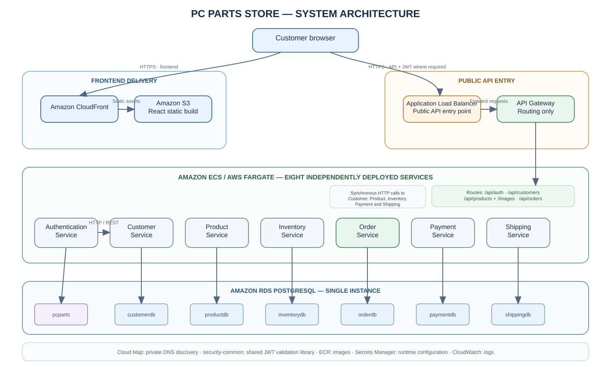
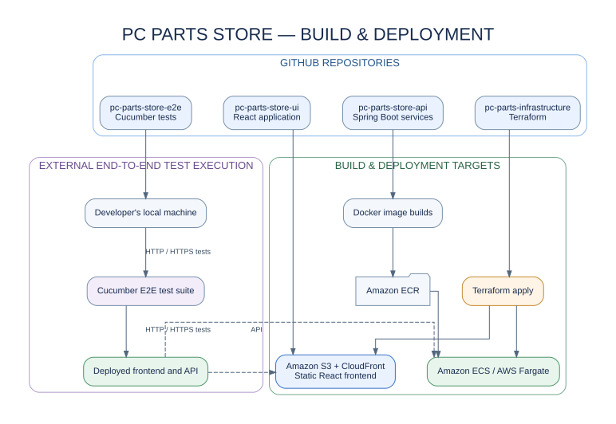
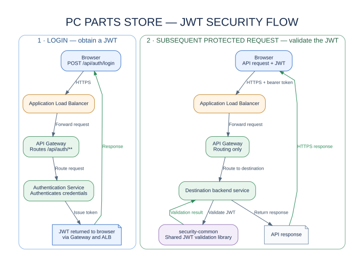

# PC Parts Store

A full-stack e-commerce application demonstrating enterprise software engineering, microservices architecture, automated testing and AWS infrastructure as code.

## Overview

PC Parts Store is a distributed application designed to demonstrate the design, development, testing and deployment of a modern e-commerce platform.

The solution comprises four independently maintained projects.

## Architecture

### System Architecture

### Deployment Architecture

### Security Flow

The editable Mermaid diagram sources are also included in [`docs/architecture/`](docs/architecture/).

## Project Repositories

The PC Parts Store platform is maintained across four independent repositories:

| Repository | Description |
|---|---|
| [pc-parts-store-api](https://github.com/craig-fox/pc-parts-store-api) | Spring Boot microservices backend |
| [pc-parts-store-ui](https://github.com/craig-fox/pc-parts-store-ui) | React frontend application |
| [pc-parts-store-e2e](https://github.com/craig-fox/pc-parts-store-e2e) | Cucumber end-to-end tests |
| [pc-parts-infrastructure](https://github.com/craig-fox/pc-parts-infrastructure) | Terraform and AWS infrastructure |

## Engineering Highlights

- Microservices architecture
- REST API design and implementation
- JWT authentication and authorisation
- Service-to-service communication
- Resilience and fault tolerance
- Idempotent order processing
- Database migrations with Flyway
- Unit and integration testing
- Cucumber end-to-end testing
- Infrastructure as code with Terraform
- AWS deployment architecture
- CI/CD and automated quality checks

## Technology Stack

Java 25, Spring Boot 4, React, TypeScript, PostgreSQL, Cucumber, Maven, Docker, Terraform and AWS.

## Project Documentation

See the individual repositories for implementation details, build instructions and technical documentation.